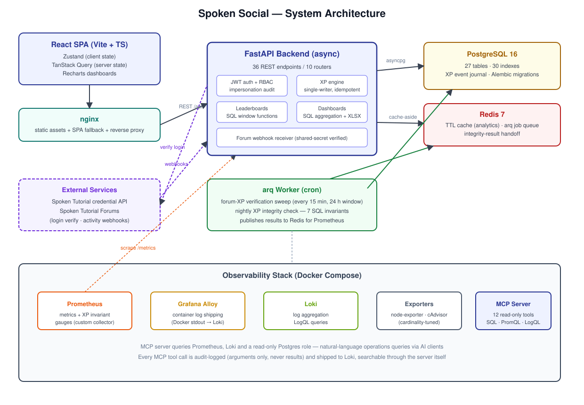
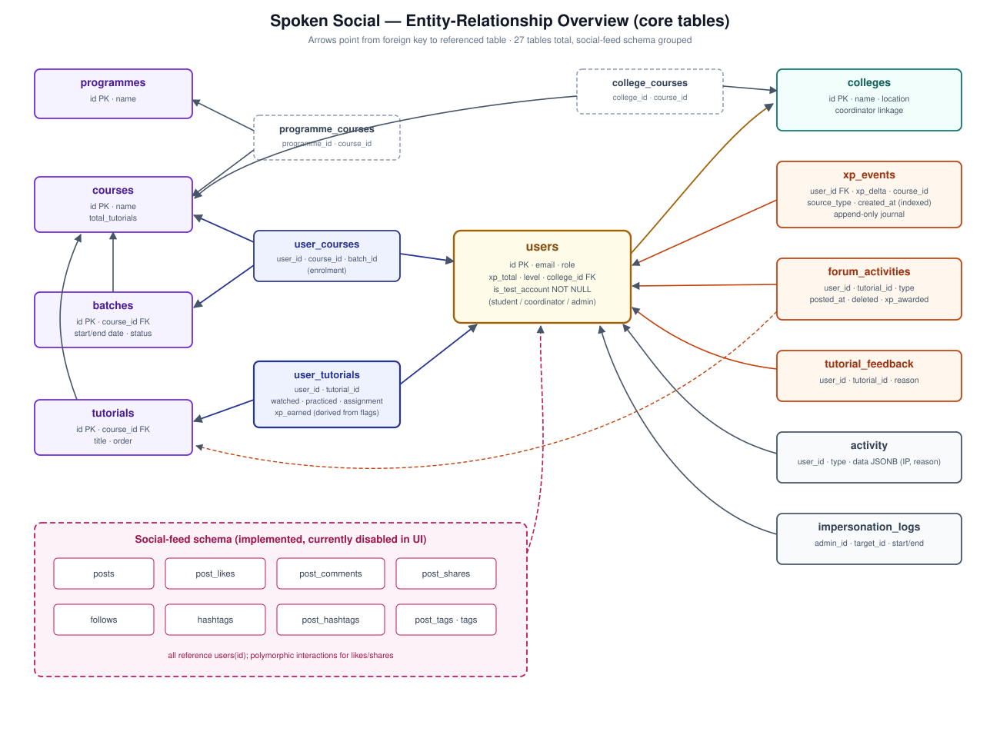
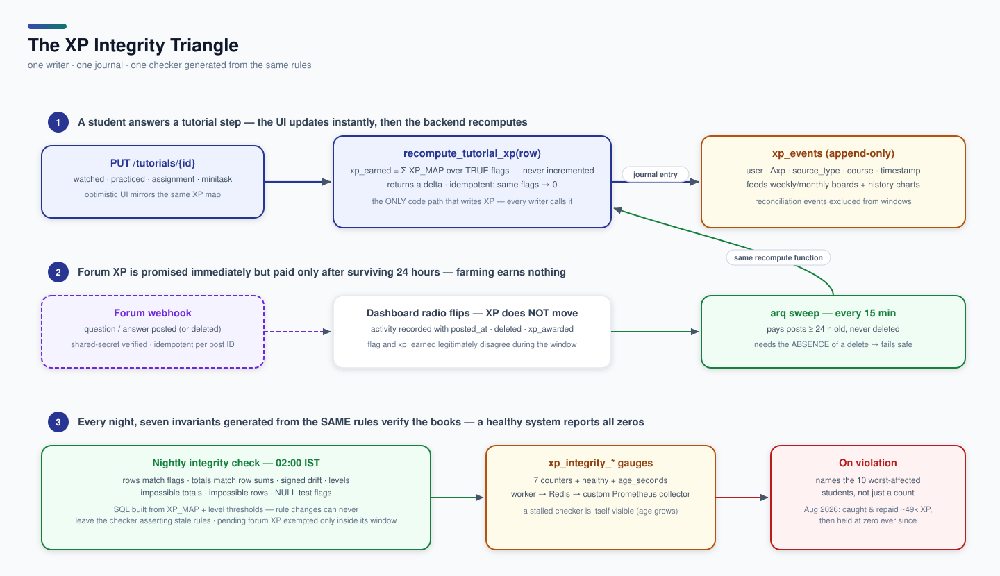

# Spoken Social — Gamified Learning Platform


A gamified learning management platform for [Spoken Tutorial](https://spoken-tutorial.org) cohort programmes. Students track per-tutorial progress and earn XP, levels, and leaderboard positions; college coordinators and programme administrators get live, drill-down analytics for every institution on the platform.

In production serving **5,400+ students across 170+ colleges** (two cohorts: a live Faculty Development Programme cohort plus an imported legacy cohort), deployed as Docker Compose on a single cloud VM.

The engineering centre of gravity is **correctness at scale**: XP is accounting-like state written concurrently by user actions, external webhooks, and data imports — so the design uses a single-writer XP engine, an append-only event journal, and nightly machine-checked invariants, with all analytics computed in SQL at constant query cost.

**Jump to:** [Features](#features) · [Architecture](#architecture) · [Getting Started](#getting-started) · [Testing](#testing) · [Deployment](#deployment) · [Docs Index](#documentation-index)

---

## Features

- **Tutorial progress tracking** — per-tutorial state (watched / practiced / assignment / mini-task) with progressive unlocking; answering "No" routes through a feedback modal that feeds admin analytics; archived batches become read-only.
- **XP & levels** — fixed rule map (watch 10, practice 10, assignment 5, forum ask 5, forum answer 10), six level tiers, every change journaled to an append-only `xp_events` table.
- **Leaderboards** — three scopes (global / college / course) × three windows (all-time / monthly / weekly), competition-style tie ranking via SQL `RANK()`, IST-correct window boundaries, and the viewer's own rank always returned. Served straight from PostgreSQL — a measured 0.11 ms per read made a cache unnecessary (see `docs/leaderboard-cache-coherence.md` for why the cache that used to exist was removed).
- **Forum XP with anti-abuse** — forum posts arrive via signed webhooks; XP pays out only after a post survives a 24-hour verification window undeleted, so post-then-delete farms nothing.
- **Institutional analytics** — coordinator (per-college) and admin (platform-wide) dashboards: status cohorts, comparisons, daily-XP charts, feedback drill-downs, styled Excel exports. All aggregation happens in SQL (the per-college summary is 3 queries regardless of college count).
- **RBAC + impersonation** — student / coordinator / admin roles enforced per route; admins can impersonate for support through the ordinary token flow, audit-logged start to end.
- **Nightly integrity invariants** — seven SQL invariants generated from the XP rules themselves, run nightly by the worker and exposed as Prometheus gauges; violations name the worst-affected students.
- **AI-queryable observability** — a 12-tool read-only [MCP](https://modelcontextprotocol.io) server over PostgreSQL, Prometheus, and Loki, with structured audit logging (arguments, never results).
- A social feed (posts, likes, comments, follows) is implemented but currently disabled in the UI.

---

## Architecture

<picture>
  <source media="(prefers-color-scheme: dark)" srcset="docs/img/architecture-dark.svg">
  
</picture>

Eleven Compose services: React SPA behind nginx, async FastAPI backend, PostgreSQL 16, Redis 7, an arq worker, and the observability group (Prometheus, node-exporter, cAdvisor, Loki, Grafana Alloy, MCP server). Redis has three duties: fail-open TTL cache for analytics, arq job queue, and the handoff channel carrying integrity results from worker to backend.

<picture>
  <source media="(prefers-color-scheme: dark)" srcset="docs/img/erd-dark.svg">
  
</picture>

### The XP integrity triangle

<picture>
  <source media="(prefers-color-scheme: dark)" srcset="docs/img/xp-flow-dark.svg">
  
</picture>

One function writes XP, one journal records it, one checker generated from the same rules verifies it nightly — that triangle is the whole integrity story.

| Layer | Technology |
|---|---|
| Backend | FastAPI 0.133 (async end-to-end), SQLAlchemy 2.0 over asyncpg, Alembic (19 migrations) |
| Background jobs | arq — forum-XP verification sweep every 15 min; nightly integrity check at 02:00 IST |
| Database | PostgreSQL 16 — 27 tables, 30 indexes (incl. covering indexes for course-XP sums) |
| Cache / queue | Redis 7 (cache-aside with 120–300 s TTLs; fail-open on outage) |
| Frontend | React 19 + TypeScript (strict), Vite 7, Zustand + TanStack Query, Tailwind CSS 4, Recharts |
| Auth | Spoken Tutorial credential API verification (no local passwords), JWT HS256, 24 h expiry |
| Observability | Prometheus, Loki, Grafana Alloy, node-exporter, cAdvisor (cardinality-tuned), custom MCP server |

### Design decisions worth knowing

1. **Single-writer XP.** `UserTutorial.xp_earned` is always recomputed from the row's flags — never incremented. Every writer calls `services/xp.py::recompute_tutorial_xp`, which is idempotent and returns a delta. Double-counting is structurally impossible; repeated webhook deliveries are harmless.
2. **Fat database, thin application.** Dashboards aggregate with SQL `CASE`/`GROUP BY` inside grouped subqueries — the platform summary is one aggregate query; loading cohorts into Python is a bug, not a pattern.
3. **Measure before caching.** The leaderboard has no cache on purpose: a top-100 over a covering descending index costs the same at 100,000 students as at 5,000, and the Redis mirror it replaced caused every leaderboard bug found in the August 2026 audit.
4. **Invariants generated from rules.** The nightly checker builds its SQL from `XP_MAP` and the level thresholds, so changing the earning rules can never leave the checker asserting stale ones.
5. **Fail-safe by absence.** Forum XP requires the *absence* of a delete event rather than the successful delivery of one; a stalled worker fires an invariant instead of staying invisible.

---

## Getting Started

Prerequisites: Python 3.10+, Node 18+, PostgreSQL 16, Redis 7 (Redis optional locally — the cache is fail-open and the worker is only needed for forum XP / nightly checks).

```bash
# Backend — backend/.env needs DATABASE_URL and JWT_SECRET
cd backend
python -m venv venv && source venv/bin/activate
pip install -r requirements.txt
alembic upgrade head
uvicorn main:app --reload --host 0.0.0.0 --port 8000   # docs at :8000/docs

# Worker (optional locally)
arq worker.WorkerSettings

# Frontend
cd ../frontend
npm install
npm run dev                                             # :5173
```

Key environment variables: `DATABASE_URL`, `JWT_SECRET`, `REDIS_URL`, `APP_TIMEZONE` (default `Asia/Kolkata` — governs every daily/weekly chart bucket), `DEV_BYPASS_ENABLED` (local-only login bypass; **must be unset in production**), `VITE_API_URL` (frontend build). The Compose stack reads `POSTGRES_*` and `MCP_DATABASE_URL` from a `.env` beside `docker-compose.yml`.

## Testing

```bash
cd backend && PYTHONPATH=. pytest
```

110 test functions (128 collected) run against a **real disposable PostgreSQL database** — not SQLite, not mocks — because the leaderboard depends on window functions and three-valued NULL semantics that mocks would not exercise. The conftest creates a throwaway DB per session and truncates between tests; legacy ad-hoc scripts are quarantined via `collect_ignore`.

## Deployment

Production is Docker Compose on a cloud VM; one `docker-compose.yml` is tracked in git and used in every environment, with per-host differences confined to `.env`.

```bash
git pull
docker compose up -d --build       # ALWAYS rebuild BEFORE migrating — running
                                   # alembic in a stale image silently no-ops
docker compose exec backend alembic upgrade head
```

Database backups via `backup_db.sh`. Rollback: check out the previous commit and rebuild. Destructive seed/reset scripts refuse to run against a non-local `DATABASE_URL` unless explicitly overridden (`backend/scripts/_guard.py`).

---

## Repository Layout

```
spoken-social/
|-- backend/
|   |-- routes/            # 10 routers, 36 REST endpoints
|   |-- services/          # xp, leaderboard, forum, integrity, ...
|   |-- models/            # 27 SQLAlchemy models, 30 indexes
|   |-- alembic/versions/  # 19 migrations incl. legacy-cohort backfills
|   |-- tests/             # pytest vs a real throwaway PostgreSQL
|   |-- scripts/           # seed / reconcile / guard scripts
|   |-- worker.py          # arq cron jobs
|   `-- integrity_metrics.py  # custom Prometheus collector
|-- frontend/src/          # React 19 + TS strict; stores, query hooks, components
|-- mcp-observability/     # 12-tool read-only MCP server
|-- observability/         # Prometheus, Loki, Alloy configuration
|-- docs/                  # design docs and post-mortems (index below)
`-- docker-compose.yml     # all 11 services, one file
```

## Documentation Index

| Document | What it is |
|---|---|
| [docs/SPOKEN_SOCIAL_PRODUCT_BRIEF.md](docs/SPOKEN_SOCIAL_PRODUCT_BRIEF.md) | **Product & Application Brief** (User-directed, non-technical): purpose, personas, core features, hosted learning activities, and future roadmap. Available in [.docx](docs/Spoken_Social_Product_Brief.docx) and [.pdf](docs/Spoken_Social_Product_Brief.pdf). |
| [docs/SPOKEN_SOCIAL_TECHNICAL_BRIEF.md](docs/SPOKEN_SOCIAL_TECHNICAL_BRIEF.md) | **Technical & Architecture Brief** (Engineering-focused): system architecture, single-writer XP engine, SQL invariants, sub-ms leaderboards, and scale roadmap. Available in [.docx](docs/Spoken_Social_Technical_Brief.docx) and [.pdf](docs/Spoken_Social_Technical_Brief.pdf). |
| [DESIGN.md](DESIGN.md) | Original product-design document (Feb 2026) — vision, personas, page-by-page UX. Partly aspirational; see its status banner. |
| [docs/SYSTEM_DESIGN.md](docs/SYSTEM_DESIGN.md) | High-level design: current architecture audit (updated Aug 2026) + the forward-looking scale roadmap. |
| [docs/leaderboard-cache-coherence.md](docs/leaderboard-cache-coherence.md) | Post-mortem: the four-bug leaderboard family, its single root cause, and the measurements behind removing the cache. |
| [docs/dashboard-correctness-fixes.md](docs/dashboard-correctness-fixes.md) | Four rounds of dashboard correctness fixes with before/after reasoning, including the XP write-path unification. |
| [docs/mcp-observability-journey.md](docs/mcp-observability-journey.md) | Build journal of the MCP observability server, including its audit-logging design. |
| [docs/dashboard-design.md](docs/dashboard-design.md) | Dashboard UX/design notes. |
| [CLAUDE.md](CLAUDE.md) | Working conventions for coding agents: commands, design tokens, code style. |

## Contributing

This is an internship project developed for the Spoken Tutorial ecosystem. Development conventions (commands, design tokens, code style) live in [CLAUDE.md](CLAUDE.md); design rationale belongs in `docs/`, not inline comments. Feature work goes through pull requests against `master`.

## License

Not yet licensed — a LICENSE file is pending. Until one is added, all rights reserved.

## Acknowledgements

Built during an internship at EduPyramids Educational Services (SINE, IIT Bombay) under the mentorship of Saisudha Sugavanam and Madhulika Goyal, for cohort programmes of the [Spoken Tutorial](https://spoken-tutorial.org) project.
