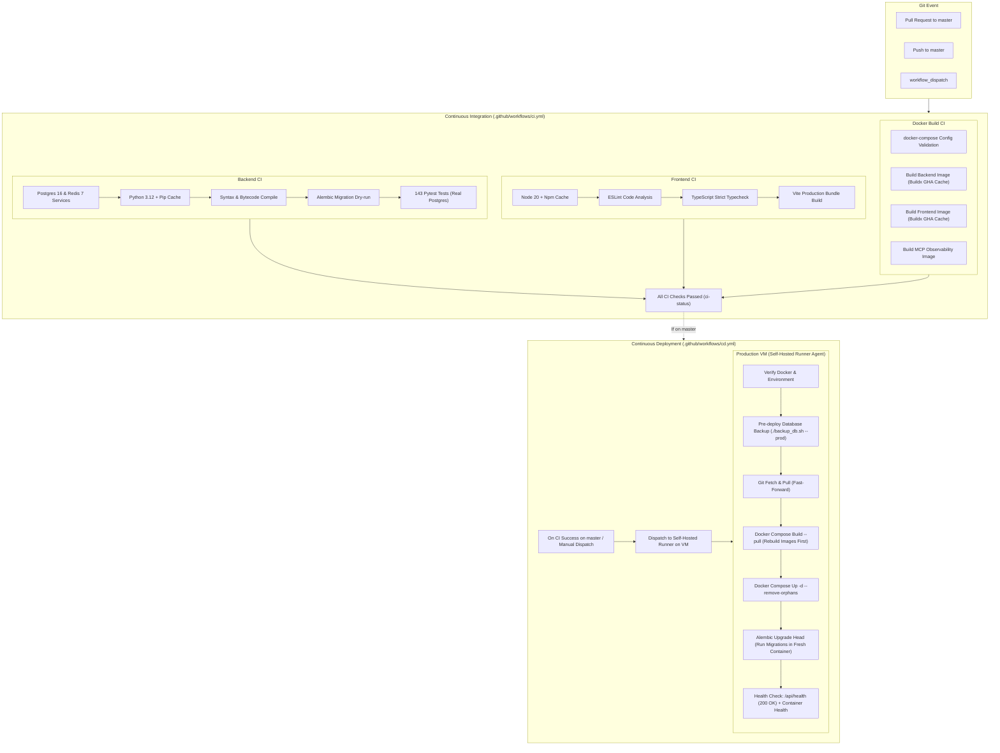

# Spoken Social — Dedicated CI/CD Pipeline

This document details the Continuous Integration and Continuous Deployment (CI/CD) architecture for **Spoken Social**, engineered for high reliability, zero-regression deployments, and machine-checked database and application integrity.

---

## 🏗️ Pipeline Architecture



---

## 1. Continuous Integration (CI)

The CI pipeline runs on every Pull Request targeting `master`, every push to `master`, and on manual dispatch. It ensures that no breaking changes reach production.

### Workflow File: `.github/workflows/ci.yml`

| Job | Environment / Services | Tasks Executed |
|---|---|---|
| **`backend-ci`** | Ubuntu runner + `postgres:16-alpine` + `redis:7-alpine` | • Python 3.12 with pip dependency caching<br>• `python -m compileall backend` (syntax verification)<br>• `alembic upgrade head` (verifies all 19 migrations execute cleanly on empty DB)<br>• `PYTHONPATH=. pytest` (runs 143 test cases against throwaway Postgres DB)<br>• Uploads JUnit test results artifact |
| **`frontend-ci`** | Ubuntu runner + Node.js 20 | • `npm ci` with cached dependencies<br>• `npm run lint` (ESLint analysis)<br>• `npm run build` (`tsc -b && vite build`)<br>• Verifies `dist/index.html` generation |
| **`docker-ci`** | Ubuntu runner + Docker Buildx | • `docker compose config --quiet` (validates syntax of all 11 compose services)<br>• Builds `backend/Dockerfile` with GitHub Actions cache<br>• Builds `frontend/Dockerfile` with multi-stage Nginx build<br>• Builds `mcp-observability/Dockerfile` |
| **`ci-status`** | Ubuntu runner | Single gating status check that requires all 3 jobs to succeed. Used for GitHub branch protection. |

### Concurrency Policy
- Pull request commits automatically cancel older in-flight builds (`cancel-in-progress: true`), saving GitHub Actions minutes while always testing the latest commit.

---

## 2. Continuous Deployment (CD) — Self-Hosted Runner

The CD pipeline triggers automatically once all CI checks pass on the `master` branch, or on-demand via `workflow_dispatch`.

### Self-Hosted Runner Architecture
Instead of using external SSH keys, jump servers, or opening port 22 to the public internet, deployments run via a **GitHub Actions Self-Hosted Runner** installed on your Production VM.

```
┌─────────────────┐             Outbound HTTPS (Port 443)             ┌──────────────────────────────────┐
│   GitHub.com    │ ◄───────────────────────────────────────────────► │ Production VM                    │
│ (Actions Queue) │       (Long-polling — No inbound ports needed!)    │ Actions Runner (systemd service) │
└─────────────────┘                                                   │ Runs: ./scripts/deploy.sh        │
                                                                      └──────────────────────────────────┘
```

### Workflow File: `.github/workflows/cd.yml`

1. **Native Local Execution (`runs-on: [self-hosted]`):**
   - Dispatches jobs directly to the runner agent running on your VM.
   - Verifies Docker connectivity and that the runner user has permissions to the Docker daemon (`docker ps`).
   - Restricts deployment concurrency (`cancel-in-progress: false`) so production deployments queue safely without state races.

2. **Deployment Runner Script: `scripts/deploy.sh`:**
   - **Step 1 (Pre-flight):** Verifies Docker, Docker Compose, and `.env` presence.
   - **Step 2 (Safety Backup):** Invokes `./backup_db.sh --prod` to snapshot the database before running migrations.
   - **Step 3 (Code Sync):** Pulls the latest commits with `git pull --ff-only origin master`.
   - **Step 4 (Image Rebuild):** Rebuilds Docker images *before* running migrations. Per engineering documentation, running Alembic inside a stale container image can silently no-op.
   - **Step 5 (Orchestration & Migration):** Runs `docker compose up -d --remove-orphans` and applies `docker compose exec -T backend alembic upgrade head`.
   - **Step 6 (Verification):** Verifies all core services (`backend`, `postgres`, `redis`, `frontend`) are running, and queries `http://127.0.0.1:8000/api/health` to confirm HTTP 200.

---

## 3. Self-Hosted Runner Setup Guide

### Handling An Existing Runner On Your Server
If you already have a GitHub Actions runner running on your VM for another application:

#### Case A: If your existing runner is an Organization-level runner
If your organization owns both repositories:
1. Go to **Organization Settings** → **Actions** → **Runners**.
2. Click your runner or runner group → **Repository access**.
3. Ensure `spoken-social` is added to the list of allowed repositories.
4. That's it! The existing runner will process jobs for `spoken-social` when triggered.

#### Case B: If your existing runner is a Repository-level runner (for a different repo)
A repository-level runner is tied to one specific repository. To run jobs for `spoken-social`, you can run a **second runner instance side-by-side on the exact same VM**:
1. SSH into your production VM.
2. Create a separate folder for the `spoken-social` runner:
   ```bash
   mkdir -p ~/actions-runner-spoken-social && cd ~/actions-runner-spoken-social
   ```
3. Download the runner package:
   ```bash
   curl -o actions-runner-linux-x64.tar.gz -L https://github.com/actions/runner/releases/download/v2.321.0/actions-runner-linux-x64-2.321.0.tar.gz
   tar xzf ./actions-runner-linux-x64.tar.gz
   ```
4. Get your registration token from GitHub:
   - Navigate to `https://github.com/shagnik2704/spoken-social` → **Settings** → **Actions** → **Runners** → **New self-hosted runner**.
   - Copy the token and configure the runner:
     ```bash
     ./config.sh --url https://github.com/shagnik2704/spoken-social --token <YOUR_REGISTRATION_TOKEN> --name spoken-social-prod-runner --labels production
     ```
5. Install and start it as an independent systemd service:
   ```bash
   # Install service with a unique name so it doesn't conflict with your other runner
   sudo ./svc.sh install ubuntu spoken-social-runner
   sudo ./svc.sh start
   sudo ./svc.sh status
   ```

### Docker Permissions for Runner User
Ensure the user running the actions runner (e.g. `ubuntu`) belongs to the `docker` group:
```bash
sudo usermod -aG docker $(whoami)
```
*(If you just added the user to the group, restart the runner service with `sudo ./svc.sh stop && sudo ./svc.sh start`)*.

---

## 4. Local Testing & Manual Deployment

You can run the same checks locally before pushing code:

### Run Backend CI Checks Locally:
```bash
# Compile check
python3 -m compileall backend

# Run Pytest against local PostgreSQL
cd backend
PYTHONPATH=. TEST_DATABASE_URL="postgresql://localhost:5432/spoken_social_test" venv/bin/pytest
```

### Run Frontend CI Checks Locally:
```bash
cd frontend
npm run lint
npm run build
```

### Run Deployment Script Manually on Server:
```bash
# Standard deployment (with backup)
./scripts/deploy.sh

# Fast deploy (skip backup)
./scripts/deploy.sh --skip-backup

# Deploy without pulling latest git commits
./scripts/deploy.sh --no-pull
```

---

## 5. Rollback Procedure

If a deployed version causes unexpected behavior:

1. **Revert commit or checkout previous tag/commit:**
   ```bash
   git checkout <PREVIOUS_STABLE_COMMIT_SHA>
   ```
2. **Rebuild and restart containers:**
   ```bash
   docker compose build
   docker compose up -d
   ```
3. **If a database rollback is required:**
   Restore the pre-deployment backup created automatically by `scripts/deploy.sh`:
   ```bash
   # List recent backups
   ls -lh backups/

   # Restore database
   gunzip -c backups/spoken_social_prod_YYYY-MM-DD_HH-MM-SS.sql.gz | docker compose exec -T postgres psql -U spoken_user -d spoken_social
   ```
